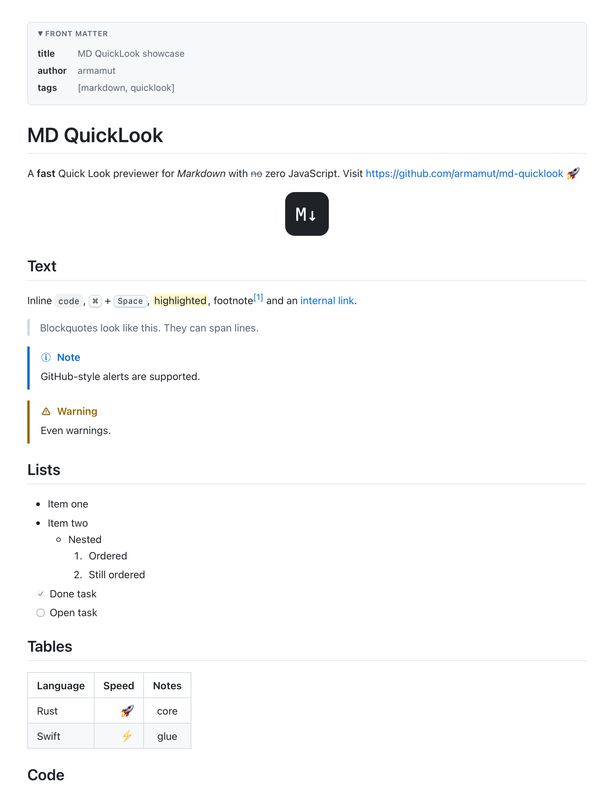
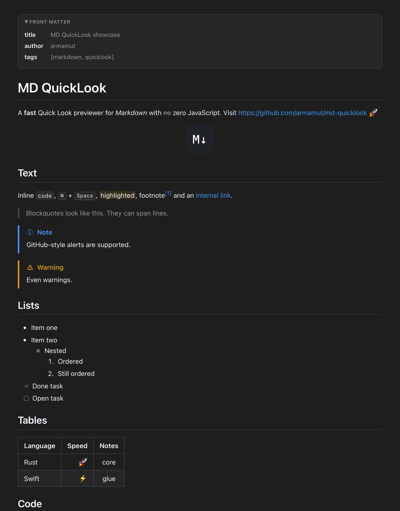

<p align="center"></p>

<h1 align="center">MD QuickLook</h1>

<p align="center">
  A fast, native Quick Look extension for Markdown on macOS.<br>
  Press <kbd>Space</kbd> on a <code>.md</code> file in Finder and read it — rendered, highlighted, in light or dark.
</p>

<p align="center">
  <a href="https://github.com/armamut/md-quicklook/actions/workflows/ci.yml"></a>
  <a href="LICENSE"></a>
  
</p>

<p align="center">
  
  
</p>

## Features

- **Works everywhere Quick Look does** — the space-bar panel, Finder's preview pane and the column view, using the full width available.
- **GitHub Flavored Markdown** — tables, task lists, strikethrough, autolinks, footnotes, `> [!NOTE]` alerts, heading anchors, emoji `:shortcodes:`, ==highlights==, front matter (shown as a table).
- **Syntax highlighting** for 220 languages, GitHub-style colours in light mode and One Half Dark in dark mode.
- **Math** — `$inline$`, `$$display$$` and ` ```math ` blocks, rendered as native MathML.
- **Local images** next to the file are embedded (``, ``).
- **Badges without the network** — static shields.io badges are drawn locally in their real colours; other remote images show their description. Loading remote images can be turned on in the app.
- **Light and dark** follow the system appearance.
- **Clickable links** — headings scroll, links to other Markdown files open them.
- **Finder thumbnails** — icons show a miniature of the document.
- **Private by design** — no JavaScript, no network requests, strict Content-Security-Policy, sandboxed.

## Fast

The renderer is written in Rust ([comrak](https://github.com/kivikakk/comrak) + [syntect](https://github.com/trishume/syntect)) and turns a typical README into HTML in about **1 ms**; a 900 KB changelog takes ~30 ms.

Two things usually make previews slow, and both are handled ahead of time:

- **Regex compilation for highlighting.** Grammars are pre-processed at build time so Oniguruma compiles them 3–5× faster (TypeScript: 45 → 13 ms, C++: 15 → 3 ms on first use), and common languages are compiled in the background on all cores while macOS is still launching the extension.
- **WebKit start-up.** A web view and its helper processes are warmed up during launch, and a spare one is kept ready for the next preview.

## Install

**One line** (downloads the latest release into `/Applications`):

```sh
curl -fsSL https://raw.githubusercontent.com/armamut/md-quicklook/main/scripts/install.sh | bash
```

**Manually:** download `MD-QuickLook-x.y.z.zip` from [Releases](https://github.com/armamut/md-quicklook/releases), move *MD QuickLook.app* to `/Applications` and open it once. The app is not notarized, so remove the quarantine flag first:

```sh
xattr -dr com.apple.quarantine "/Applications/MD QuickLook.app"
```

**From source** (needs Rust and the Xcode Command Line Tools — full Xcode is not required):

```sh
git clone https://github.com/armamut/md-quicklook.git
cd md-quicklook
make install
```

Opening the app registers the extensions; after that it can be closed. If previews do not appear, check that *MD QuickLook* is enabled in **System Settings ▸ General ▸ Login Items & Extensions ▸ Quick Look**, then click **Reset Quick Look** in the app.

## Uninstall

```sh
make uninstall    # or drag the app to the Trash
```

## How it works

```
core/      Rust renderer: Markdown → self-contained HTML (static library + `mdql` CLI)
macos/     Swift: host app, preview extension (WKWebView), thumbnail extension
scripts/   build.sh (Xcode-free build), install.sh, icon and screenshot helpers
```

The preview extension reads the file, calls the Rust core through a small C API (`core/include/mdql.h`) and shows the result in a sandboxed web view with JavaScript disabled. Local images are embedded as `data:` URIs, so the page never needs file or network access.

Useful while developing:

```sh
make test                                   # Rust tests
make bench                                  # render timing
core/target/release/mdql README.md -o out.html --theme dark
log stream --predicate 'subsystem == "io.github.armamut.mdquicklook"'   # extension timings
```

## Credits

Built by [armamut](https://github.com/armamut) together with [Claude Code](https://claude.com/claude-code) (Claude Opus 5.5 by Anthropic).
Third-party components are listed in [THIRD_PARTY_NOTICES.md](THIRD_PARTY_NOTICES.md).

## License

[MIT](LICENSE)
