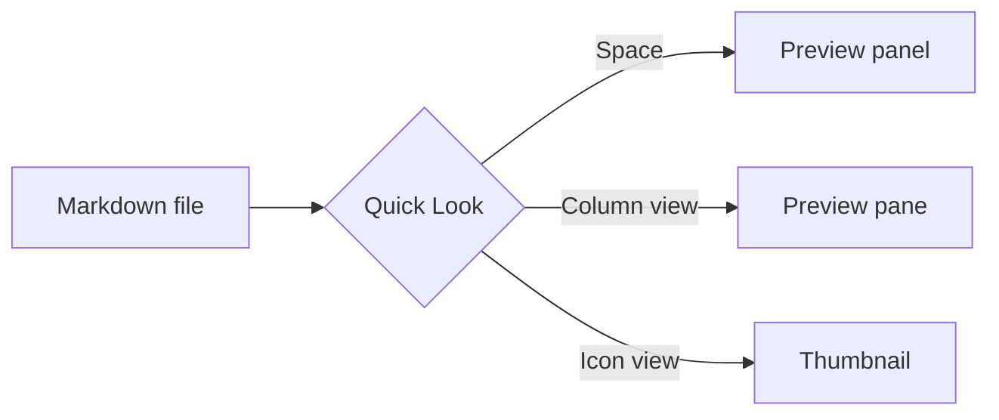
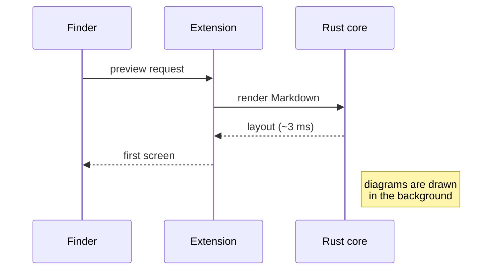
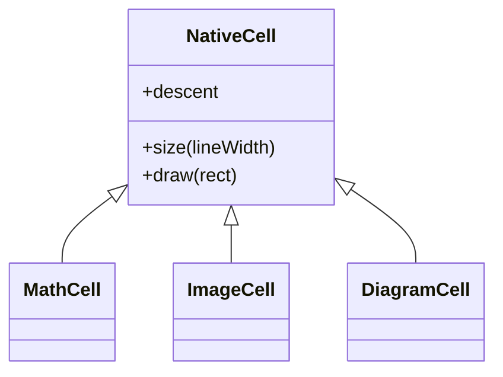
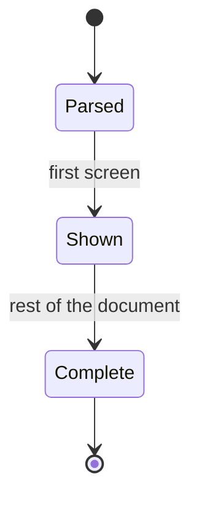
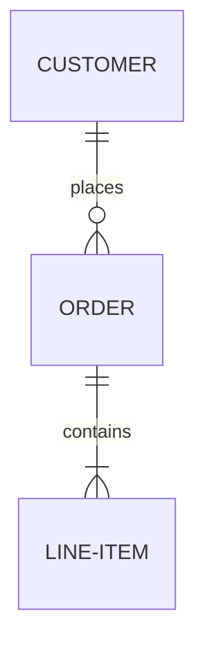
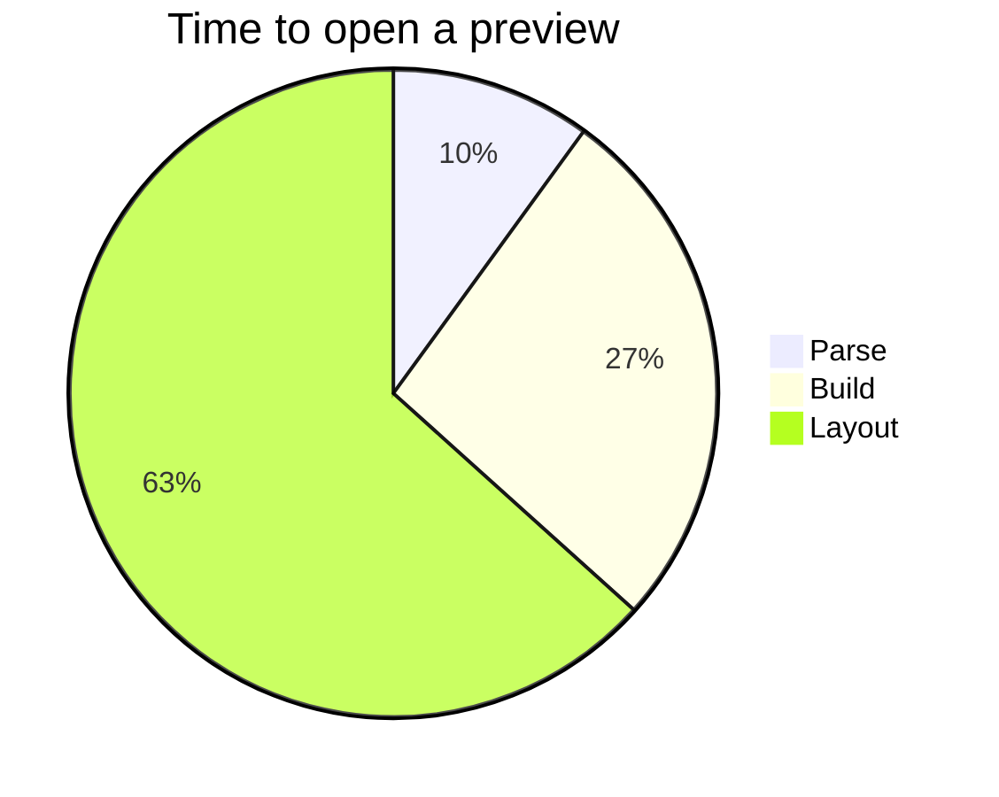
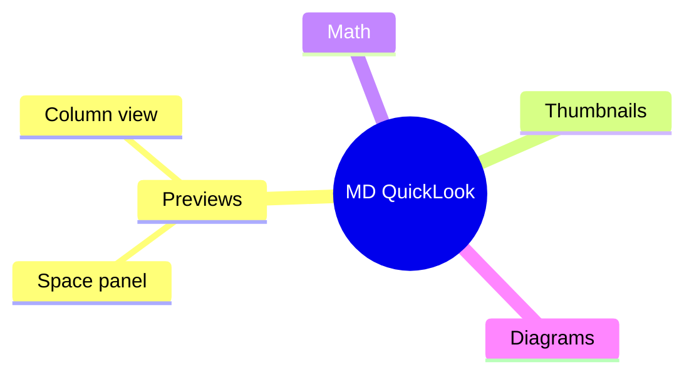

# Diagrams

` ```mermaid ` blocks are drawn as diagrams, natively: no browser, no
JavaScript. They follow light and dark mode. A block that cannot be drawn
stays visible as its source.

## Flowchart



## Sequence



## Class



## State



## Entity relationship



## Pie



## Mind map


